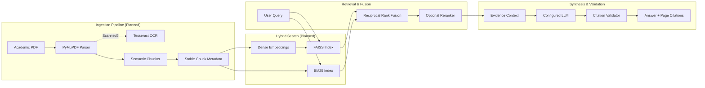

# Multimodal RAG Research Assistant

[](https://fastapi.tiangolo.com)
[](https://www.python.org/)
[](https://docs.pydantic.dev/)
[](IMPLEMENTATION_STATUS.md)

An academic AI research assistant engineered to parse dense research papers (PDFs), extract multi-column text and tables, perform hybrid dense and keyword retrieval, generate strictly grounded syntheses, and provide verifiable page-level citations.

> **Current Implementation Notice**: This repository is currently in **Phase 0 (Repository Foundation)**. Core API scaffolding, configuration management, health audit endpoints, testing harness, and API contracts are **Implemented and tested**. Multimodal PDF parsing, OCR, FAISS vector indexing, BM25 keyword search, and LLM answer generation are **Planned capabilities** that will be built progressively in subsequent phases.

---

## 1. Problem Statement & Motivation
Academic research publications present distinctive hurdles for standard Retrieval-Augmented Generation (RAG) systems:
1. **Multi-Column and Non-Linear Layouts**: Academic PDFs routinely place text in dual columns with floating tables, figures, footnotes, and equation blocks. Generic text extraction scrambles sentence flow and breaks paragraph boundaries.
2. **Dense Domain Nomenclature & Acronyms**: Academic inquiries frequently target exact terms (e.g., `ResNet-50`, `BLEU-4`, `AdamW`), where dense embeddings alone can suffer from semantic drift, while keyword search fails to capture conceptual synonyms.
3. **Hallucination in Synthesis**: Researchers require strict factual fidelity. A research assistant must never fabricate conclusions; any unsupported claim damages research integrity.
4. **Attribution & Verification**: Researchers need instant verification, linking claims directly to specific pages and verbatim text in the source paper.

The **Multimodal RAG Research Assistant** solves these problems with layout-aware extraction, hybrid Reciprocal Rank Fusion (RRF), grounded generation prompts, and exact citation anchoring.

---

## 2. Project Objectives
- Ingest complex academic PDFs and preserve structure, metadata, and page coordinates.
- Segment documents into deterministic chunks with stable identifiers (`{doc_id}#chunk_{idx}`).
- Perform hybrid retrieval combining dense vector similarity (Sentence Transformers + FAISS) and sparse keyword relevance (BM25) via Reciprocal Rank Fusion.
- Generate grounded research answers with strict citations (e.g. `[1]`, `[2]`) referencing exact pages and text snippets.
- Provide a clear, extensible FastAPI backend and a rapid-prototype Streamlit research portal.

---

## 3. Implementation Status Matrix

| Capability / Module | Status | Description |
| :--- | :--- | :--- |
| **FastAPI Core Foundation** | **Implemented and tested** | Root info (`GET /`), Health check (`GET /health`), CORS, and lifespan |
| **Configuration Engine** | **Implemented and tested** | `pydantic-settings` with port bounds validation and secret redaction |
| **API Contract Specifications** | **Implemented and tested** | Formal Pydantic schemas for health, errors, uploads, chunks, citations |
| **Error Handling System** | **Implemented and tested** | Unified `ErrorDetail` response hiding internal paths and stack traces |
| **Unit & Smoke Tests** | **Implemented and tested** | 7 unit tests in `pytest` (100% pass) and CLI smoke test script |
| **PDF Extraction (PyMuPDF)** | **Planned (Phase 1)** | High-fidelity layout, text block, and table coordinate extraction |
| **OCR Fallback (Tesseract)** | **Planned (Phase 2)** | Scanned page detection and optical character recognition |
| **Semantic Chunking** | **Planned (Phase 1)** | Sliding window chunking with page-span preservation and stable IDs |
| **Dense Indexing (FAISS)** | **Planned (Phase 1)** | Sentence-Transformers embeddings stored in FAISS vector index |
| **Sparse Keyword Search (BM25)**| **Planned (Phase 4)** | Okapi BM25 keyword index for acronym and terminology search |
| **Hybrid Ranking (RRF)** | **Planned (Phase 4)** | Reciprocal Rank Fusion over rank positions without score mixing |
| **Cross-Encoder Reranker** | **Optional (Phase 4)** | Sentence Transformers cross-encoder for candidate reranking |
| **Grounded LLM Synthesis** | **Planned (Phase 5)** | LLM provider abstraction with strict evidence grounding prompts |
| **Traceable Citations** | **Planned (Phase 5)** | Automated citation validator linking answers to source pages/snippets |
| **Interactive UI** | **Planned (Phase 6)** | Streamlit research interface with citation inspector and PDF viewer |
| **Evaluation Suite** | **Planned (Phase 7)** | Quantitative retrieval metrics (Hit@K, MRR) and RAG triad evaluation |

---

## 4. System Architecture



---

## 5. Technology Stack

- **Language**: Python 3.11+ (Baseline: Python 3.11.15 / compatible through 3.13)
- **Backend Framework**: [FastAPI](https://fastapi.tiangolo.com/) with [Pydantic v2](https://docs.pydantic.dev/) and `pydantic-settings`
- **ASGI Web Server**: [Uvicorn](https://www.uvicorn.org/)
- **Document Extraction**: [PyMuPDF (fitz)](https://pymupdf.readthedocs.io/) *(Planned Phase 1)*
- **OCR Engine**: [Tesseract OCR](https://github.com/tesseract-ocr/tesseract) via [pytesseract](https://pypi.org/project/pytesseract/) *(Planned Phase 2)*
- **Dense Embeddings**: `sentence-transformers/all-MiniLM-L6-v2` *(Planned Phase 1)*
- **Vector Search Index**: [FAISS (faiss-cpu)](https://github.com/facebookresearch/faiss) *(Planned Phase 1)*
- **Keyword Retrieval**: [rank-bm25](https://pypi.org/project/rank-bm25/) *(Planned Phase 4)*
- **Reranker (Optional)**: Sentence Transformers Cross-Encoder *(Optional Phase 4)*
- **Metadata Persistence**: SQLite for local rapid prototyping; PostgreSQL with optional Docker *(Planned Phase 3)*
- **Answer Generation**: Configurable LLM provider abstraction (OpenAI, Anthropic, Ollama, Groq) *(Planned Phase 5)*
- **User Interface**: [Streamlit](https://streamlit.io/) rapid prototype *(Planned Phase 6)*
- **Testing & Quality**: [pytest](https://docs.pytest.org/), [pytest-asyncio](https://github.com/pytest-dev/pytest-asyncio), [httpx](https://www.python-httpx.org/), [Ruff](https://docs.astral.sh/ruff/)

---

## 6. Repository Structure

```
DL-cp/
├── README.md                      # Comprehensive project overview and documentation
├── CONTRIBUTING.md                # Development standards and PR contribution guide
├── LICENSE                        # Licensing notice (decision pending team selection)
├── .gitignore                     # Git exclusion rules (safeguards secrets, uploads, indexes)
├── .gitattributes                 # Line-ending normalization (LF) and binary tracking
├── .env.example                   # Environment configuration template with safe defaults
├── pyproject.toml                 # Standardized project metadata and build configuration
├── requirements.txt               # Core runtime dependencies
├── requirements-dev.txt           # Development, linting, and testing dependencies
├── docker-compose.yml             # Optional development PostgreSQL service
├── Makefile                       # Convenient developer shortcuts (install, dev, test, lint)
├── IMPLEMENTATION_STATUS.md       # Living ledger of implementation status and test proofs
├── CHANGELOG.md                   # Semantic version changelog
├── docs/                          # Detailed technical documentation suite
│   ├── PROJECT_OVERVIEW.md        # Problem statement, motivation, and scope
│   ├── ARCHITECTURE.md            # Topology, sequence diagrams, and design rules
│   ├── API_CONTRACTS.md           # Formal OpenAPI contracts and schemas
│   ├── DEVELOPMENT_SETUP.md       # macOS, Linux, and Windows setup instructions
│   ├── TEAM_WORKFLOW.md           # 4-person team roles, branching, and PR rules
│   ├── TESTING_AND_EVALUATION.md  # Multi-tier testing and RAG triad evaluation
│   ├── SECURITY_AND_PRIVACY.md    # Threat model, secret safeguards, and data privacy
│   └── ROADMAP.md                 # Implementation phases 0 to 8 with acceptance gates
├── app/                           # Core FastAPI application package
│   ├── __init__.py                # Package version (0.1.0)
│   ├── main.py                    # Application factory, endpoints, and error handlers
│   ├── config.py                  # Pydantic-settings configuration with secret masking
│   ├── schemas.py                 # Pydantic models for API contracts, chunks, citations
│   ├── api/                       # API route modules (Phase 2+)
│   │   └── __init__.py
│   └── services/                  # Business logic (retrieval, synthesis) (Phase 1+)
│       └── __init__.py
├── ingestion/                     # Document extraction and chunking pipeline (Phase 1)
│   └── __init__.py
├── rag_engine/                    # Embeddings, FAISS, BM25, and RRF ranking (Phase 1 & 4)
│   └── __init__.py
├── evaluation/                    # Retrieval benchmarks and RAG evaluation harness
│   └── README.md                  # Evaluation methodology and dataset schema
├── tests/                         # Multi-tier test suite
│   ├── __init__.py
│   ├── unit/                      # Fast unit tests (config, health, schemas)
│   │   ├── __init__.py
│   │   ├── test_config.py
│   │   └── test_health.py
│   ├── integration/               # Integration tests (Phase 2+)
│   │   └── __init__.py
│   └── e2e/                       # End-to-end user journey tests (Phase 6+)
│       └── __init__.py
├── scripts/
│   └── smoke_test.py              # CLI smoke test verifying running API health
├── data/
│   └── uploads/                   # Runtime PDF storage (excluded from git)
│       └── .gitkeep
└── indexes/                       # Vector and BM25 index artifacts (excluded from git)
    └── .gitkeep
```

---

## 7. Supported Input Formats
- **Standard Academic PDFs**: Multi-column papers, digital text, and embedded vector graphics (`.pdf`).
- **Scanned / Degraded PDFs**: Supported via automated Tesseract OCR fallback *(Planned Phase 2)*.
- **Maximum File Size**: Configurable via `MAX_UPLOAD_SIZE_MB` (default: 25 MB).

---

## 8. Local Installation & Setup

### 8.1 Clone & Environment Setup
```bash
# Clone the repository
git clone https://github.com/gaurikadalge/DL-cp.git
cd DL-cp

# Create and activate virtual environment (macOS / Linux)
python3 -m venv .venv
source .venv/bin/activate

# For Windows PowerShell:
# python -m venv .venv
# .\.venv\Scripts\Activate.ps1
```

### 8.2 Install Dependencies
For Phase 0 foundation testing (lightweight, fast):
```bash
pip install -r requirements-dev.txt
# Or:
make install
```

### 8.3 Configure Environment Variables
```bash
cp .env.example .env
```
Default configuration values in `.env.example` run out-of-the-box using local SQLite without requiring external credentials or Docker.

---

## 9. Running the Application

Start the local development server:
```bash
make dev
# Or using uvicorn directly:
uvicorn app.main:app --host 127.0.0.1 --port 8000 --reload
```

Access the service:
- **Interactive OpenAPI Documentation**: [http://127.0.0.1:8000/docs](http://127.0.0.1:8000/docs)
- **Alternative ReDoc UI**: [http://127.0.0.1:8000/redoc](http://127.0.0.1:8000/redoc)
- **Health Check & Subsystem Audit**: [http://127.0.0.1:8000/health](http://127.0.0.1:8000/health)

---

## 10. API Endpoint Overview

| Method | Endpoint | Description | Phase |
| :--- | :--- | :--- | :--- |
| `GET` | `/` | Returns service name, version, and documentation links | **Implemented (Phase 0)** |
| `GET` | `/health` | Audits service health and external dependency states | **Implemented (Phase 0)** |
| `POST`| `/documents/upload` | Upload an academic PDF for ingestion and indexing | Planned (Phase 2) |
| `GET` | `/documents` | List all ingested documents and their status | Planned (Phase 3) |
| `GET` | `/documents/{id}` | Retrieve metadata and chunk count for a document | Planned (Phase 3) |
| `GET` | `/documents/{id}/status` | Check real-time ingestion status (`uploaded`, `processing`, `indexed`) | Planned (Phase 3) |
| `DELETE`| `/documents/{id}` | Purge document, text chunks, and vector index records | Planned (Phase 3) |
| `POST`| `/query` | Execute hybrid search and generate grounded answer with citations | Planned (Phase 5) |

Detailed request/response JSON contracts are documented in [docs/API_CONTRACTS.md](docs/API_CONTRACTS.md).

---

## 11. Testing & Smoke Verification

### Run Automated Unit Tests
```bash
pytest -v
# Or:
make test
```
*Current status*: 7 tests passing in 0.15s.

### Run Smoke Test Script
With the API server running in a background or separate terminal:
```bash
python scripts/smoke_test.py --url http://127.0.0.1:8000
# Or:
make smoke-test
```

### Code Formatting and Linting
```bash
ruff check .
ruff format .
# Or:
make lint
make format
```

---

## 12. Team Member Responsibilities

The project is driven by a four-member engineering team with designated module ownership:

1. **Person 1 — Deep Learning & RAG Lead**
   - Embedding configuration (`sentence-transformers`), FAISS dense index, BM25 keyword index, RRF hybrid ranking, optional cross-encoder reranker, grounded prompt design, and retrieval evaluation.
2. **Person 2 — Backend & Integration Lead**
   - FastAPI routers, SQLite/PostgreSQL persistence, document lifecycle state machine, API contracts, persistent index serialization, security, and deployment.
3. **Person 3 — Multimodal Processing Lead**
   - File validation, PyMuPDF layout parsing, Tesseract OCR fallback, table/figure caption extraction, and semantic chunking with stable IDs.
4. **Person 4 — Frontend & Evaluation Lead**
   - Streamlit user portal, citation inspector, end-to-end user journey tests, quantitative retrieval/faithfulness benchmark harness, and demo reports.

Full workflow, branch conventions, and handoff protocols are in [docs/TEAM_WORKFLOW.md](docs/TEAM_WORKFLOW.md).

---

## 13. Security, Privacy & Data Handling
- **No Committed Secrets**: `.env` is ignored by `.gitignore`. `app/config.py` provides `safe_dict()` to redact keys from logs.
- **Error Sanitization**: Global exception handlers return unified `ErrorDetail` objects; Python tracebacks and internal server filepaths are never leaked to clients.
- **Upload Restrictions**: Files are limited to `.pdf` format and `MAX_UPLOAD_SIZE_MB` (25MB).
- **Data Isolation**: Uploaded papers (`data/uploads/`), databases (`data/*.db`), and indexes (`indexes/*.faiss`) are barred from Git.
- Details in [docs/SECURITY_AND_PRIVACY.md](docs/SECURITY_AND_PRIVACY.md).

---

## 14. Known Limitations
- **Current Phase**: Only foundational API endpoints (`/` and `/health`) are active; PDF processing and LLM query endpoints are specifications for upcoming phases.
- **OCR Dependency**: Tesseract OCR requires system-level binary installation (`brew install tesseract` or `apt-get install tesseract-ocr`) when enabled.
- **Hardware Acceleration**: Phase 0 uses CPU-based FAISS (`faiss-cpu`); GPU acceleration will be evaluated if index scale requires it.

---

## 15. Contributing & Licensing
- **Contribution Guide**: Please review [CONTRIBUTING.md](CONTRIBUTING.md) for branch naming (`feature/*`), PR reviews, and coding style.
- **License**: The repository is currently unlicensed pending team/owner selection between MIT and Apache 2.0. See [LICENSE](LICENSE).