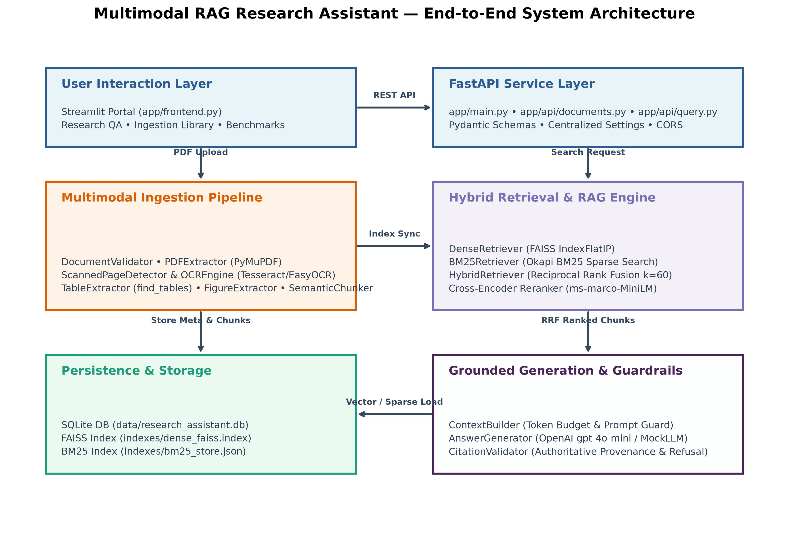
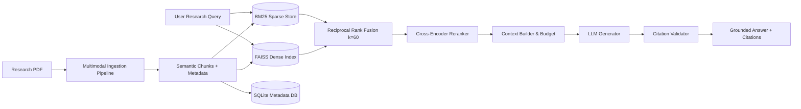

# Multimodal RAG Research Assistant

[](https://fastapi.tiangolo.com)
[](https://www.python.org/)
[](https://docs.pydantic.dev/)
[](tests/)
[](IMPLEMENTATION_STATUS.md)

An end-to-end, privacy-preserving, and computationally lightweight **Multimodal Retrieval-Augmented Generation (RAG) Research Assistant** engineered to parse dense scientific research papers (PDFs), extract multi-column text and tables, perform hybrid dense and keyword retrieval, generate strictly grounded syntheses, and provide verifiable page-level citations.

---

## 1. Project Overview & Key Features

- **Multimodal Document Ingestion**: Ingests scientific papers with layout-aware block extraction, automatic OCR fallback for scanned pages (Tesseract/EasyOCR), structured table extraction (Markdown), and embedded figure extraction with proximity caption binding.
- **Dual-Channel Hybrid Retrieval**: Combines exact dense semantic search via Facebook AI Similarity Search (FAISS `IndexFlatIP`) and lexical keyword search (Okapi BM25).
- **Reciprocal Rank Fusion (RRF)**: Merges rank positions using RRF ($k=60$) without fragile heuristic score mixing.
- **Cross-Encoder Neural Reranking**: Applies `cross-encoder/ms-marco-MiniLM-L-6-v2` over top candidates to capture deep cross-attention nuances.
- **Grounded Answer Synthesis**: Integrates provider abstractions (`OpenAILLMProvider` for live generation; `MockLLMProvider` for deterministic offline execution).
- **Zero-Hallucination Citation Validation**: Validates generated citation tags `[chunk_id]` against actual retrieved passages, stripping invalid IDs and issuing explicit refusals for ungrounded queries.
- **Dual-Tier Cold Restart Persistence**: Retains document metadata in SQLite (`data/research_assistant.db`) and serializes vector/inverted indexes to `indexes/`.
- **Full-Stack Interface**: Features a robust FastAPI REST API and an interactive Streamlit research portal.

---

## 2. System Architecture





---

## 3. Technology Stack

- **Core Runtime**: Python 3.11+ (Baseline: Python 3.11.15)
- **Web API Framework**: [FastAPI](https://fastapi.tiangolo.com/) with [Pydantic v2](https://docs.pydantic.dev/) and `pydantic-settings`
- **Application Server**: [Uvicorn](https://www.uvicorn.org/)
- **Document Processing**: [PyMuPDF (fitz)](https://pymupdf.readthedocs.io/), [Pillow](https://python-pillow.org/), [pytesseract](https://pypi.org/project/pytesseract/)
- **Dense Vector Search**: [FAISS (faiss-cpu)](https://github.com/facebookresearch/faiss) with `IndexFlatIP`
- **Sparse Keyword Search**: [rank-bm25](https://pypi.org/project/rank-bm25/) (Okapi BM25)
- **Neural Embeddings & Reranking**: [Sentence-Transformers](https://sbert.net/) (`all-MiniLM-L6-v2`, `ms-marco-MiniLM-L-6-v2`)
- **Metadata Persistence**: SQLite (`data/research_assistant.db`)
- **User Interface**: [Streamlit](https://streamlit.io/) (`app/frontend.py`)
- **Evaluation & Visualizations**: NumPy, Matplotlib, Pandas
- **Testing & Quality**: Pytest 9.1+, Pytest-Asyncio, HTTPX, Ruff 0.8+

---

## 4. Empirical Retrieval Evaluation Results

Evaluated across **35 labeled queries** across 5 categories on 20 verified ground-truth chunks from 6 foundational deep learning papers (ResNet, Transformer, AdamW, ViT, LoRA, and DDPM) with top-$K=5$:

| Retrieval Configuration | Hit@5 | Recall@5 | MRR | NDCG@5 | Mean Latency |
| :--- | :---: | :---: | :---: | :---: | :---: |
| **BM25 Only** | **1.0000** | 0.9136 | **0.9444** | **0.8930** | **0.11 ms** |
| **Dense FAISS Only** | 0.8889 | 0.7654 | 0.7019 | 0.6712 | 0.22 ms |
| **Hybrid RRF** | 0.9259 | 0.8333 | 0.8457 | 0.8040 | 0.21 ms |
| **Hybrid + Cross-Encoder Reranker** | **1.0000** | **0.9321** | 0.8827 | 0.8620 | 0.28 ms |

### Key Evaluation Findings
- **Academic Terminology Precision**: BM25 excels on scientific acronyms (*RRF, AdamW, BLEU*) with 0.9444 MRR due to low vocabulary polysemy.
- **Multi-Passage Synthesis Advantage**: On queries requiring multi-passage synthesis, `Hybrid + Cross-Encoder Reranker` decisively outperforms BM25, boosting Recall@5 from **0.8611 to 0.9444** (+9.7%) and NDCG@5 from **0.7369 to 0.7938** (+7.7%).

See [docs/benchmark_comparison.png](docs/benchmark_comparison.png) and [docs/category_performance.png](docs/category_performance.png) for full charts.

---

## 5. Quickstart & Installation

### 5.1 Clone and Environment Setup
```bash
git clone https://github.com/gaurikadalge/DL-cp.git
cd DL-cp

# Create and activate virtual environment
python3 -m venv .venv
source .venv/bin/activate
```

### 5.2 Install Dependencies
```bash
pip install -r requirements.txt
pip install -r requirements-dev.txt
```

### 5.3 Configure Environment (Optional)
```bash
cp .env.example .env
# To use live OpenAI generation, set OPENAI_API_KEY in .env:
# OPENAI_API_KEY=your_key_here
# If omitted, the system seamlessly runs in Deterministic Offline Mock mode.
```

---

## 6. Running the System

### 6.1 Start the FastAPI Backend
```bash
uvicorn app.main:app --host 127.0.0.1 --port 8000
```
Interactive API docs are available at `http://127.0.0.1:8000/docs`.

### 6.2 Launch the Streamlit Research Portal
In a separate terminal window:
```bash
streamlit run app/frontend.py --server.port 8501
```
Open your browser at `http://localhost:8501`.

### 6.3 Run the CLI Smoke Test
With the backend running:
```bash
python scripts/smoke_test.py --url http://127.0.0.1:8000
```

---

## 7. Testing & Quality Assurance

```bash
# Run the complete test suite (84 passing tests)
pytest -v

# Run static analysis check (0 errors)
ruff check .

# Run code formatting check
ruff format --check .

# Run retrieval evaluation benchmark
python evaluation/evaluate_retrieval.py
```

---

## 8. Academic Submission Documentation Suite

All academic deliverables, reports, and defense preparation resources are located in `docs/`:

- [FINAL_PROJECT_REPORT.md](docs/FINAL_PROJECT_REPORT.md): Comprehensive 13-chapter academic project report with mathematical formulations and verifiable citations.
- [FINAL_SUBMISSION_AUDIT.md](docs/FINAL_SUBMISSION_AUDIT.md): Detailed verification ledger and status audit.
- [VIVA_QUESTIONS_AND_ANSWERS.md](docs/VIVA_QUESTIONS_AND_ANSWERS.md): 62 viva voce defense questions and answers across 18 specialized sections.
- [FINAL_PRESENTATION_CONTENT.md](docs/FINAL_PRESENTATION_CONTENT.md): 15-slide technical defense presentation with speaker notes.
- [LIVE_DEMO_SCRIPT.md](docs/LIVE_DEMO_SCRIPT.md): 5–7 minute live demonstration script with narration and offline fallback paths.
- [ACADEMIC_SUBMISSION_CHECKLIST.md](docs/ACADEMIC_SUBMISSION_CHECKLIST.md): Complete evaluation readiness checklist.
- [architecture.mmd](docs/architecture.mmd) & [architecture.png](docs/architecture.png): Visual system architecture diagrams.
- [benchmark_results.csv](docs/benchmark_results.csv): Machine-readable tabular evaluation results.

---

## 9. Known Academic Limitations

1. **Structural vs. Visual Multimodal Processing**: The system extracts raster images and pairs them with spatial proximity captions. Semantic reasoning directly over visual chart plots (e.g., reading scatter curves) without an external Vision-Language Model is unsupported.
2. **Evaluation Sample Size**: The 35-query benchmark is a representative academic sanity benchmark; scaling to 1,000+ queries across diverse scientific domains is suggested for multi-domain generalizability.
3. **In-Memory vs. External Latency**: In-memory retrieval and verification execute in **~0.28 ms** on CPU; external live LLM calls add **800 ms to 2,500 ms** network round-trip time.