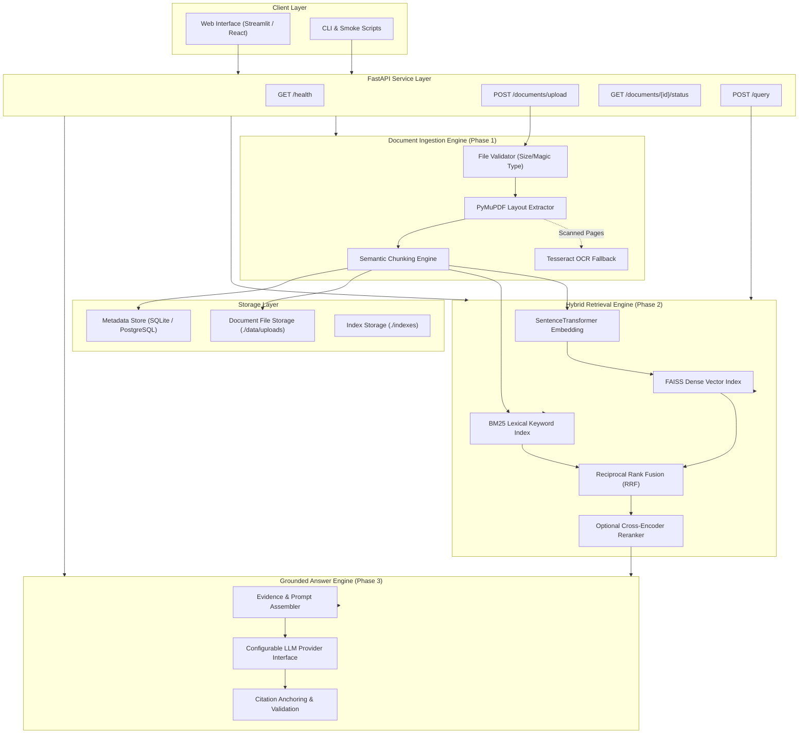
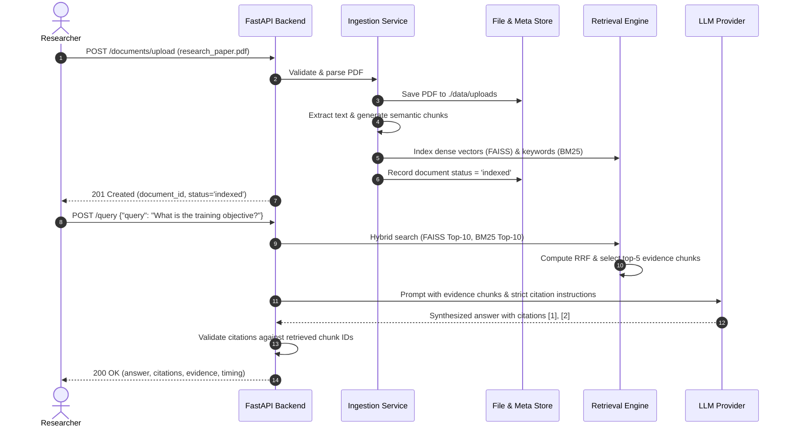

# System Architecture & Technical Design

## 1. Architectural Principles
1. **Modularity**: Strict separation between Document Ingestion, Retrieval Indexing, LLM Synthesis, and API Presentation.
2. **Determinism & Provenance**: Chunks possess immutable deterministic IDs; citations trace back to precise source files, page offsets, and verbatim excerpts.
3. **No Metric Conflation**: Raw dense vector cosine scores and BM25 scores are kept distinct and never mathematically added directly; Reciprocal Rank Fusion (RRF) operates strictly over ordinal rank positions.
4. **Resilient Degradation**: Graceful handling of image-heavy or degraded documents via OCR fallback; transparent reporting when evidence is insufficient.
5. **Security by Default**: Zero hardcoded secrets; internal server paths and tracebacks are hidden from external API clients.

---

## 2. End-to-End System Architecture

---

## 3. Subsystem Breakdown

### 3.1 Ingestion & Processing Subsystem (`ingestion/`)
- **Input Validation**: Verifies file extension (`.pdf`), validates magic bytes (header `%PDF-`), and enforces upload bounds (`MAX_UPLOAD_SIZE_MB`).
- **Extraction**: PyMuPDF extracts text blocks, tables, and bounding box positions per page.
- **OCR Fallback**: Pages with low text density or embedded images invoke Tesseract OCR.
- **Chunking**: Generates chunks with configured token limits (e.g., 300–500 tokens) with sliding overlap (50 tokens). Each chunk preserves `page_number`, `page_end`, and `section`.

### 3.2 Hybrid Retrieval Subsystem (`rag_engine/`)
- **Dense Representation**: `sentence-transformers/all-MiniLM-L6-v2` produces 384-dimensional dense vectors stored in a FAISS FlatIP or HNSW index.
- **Sparse Representation**: `rank-bm25` (Okapi BM25) indexes tokenized words, ensuring domain-specific names and equation symbols are recallable.
- **Reciprocal Rank Fusion (RRF)**:
  $$\text{RRF\_Score}(d) = \sum_{m \in \{\text{dense}, \text{bm25}\}} \frac{1}{k + r_m(d)}$$
  where $k = 60$ (smoothing constant) and $r_m(d)$ is the 1-indexed rank in retrieval list $m$.
- **Reranker (Optional)**: Cross-encoder (e.g. `cross-encoder/ms-marco-MiniLM-L-6-v2`) re-scores top $N$ candidates.

### 3.3 Grounded Generation & Citation Subsystem (`app/services/`)
- **Prompt Architecture**: System instructions force the model to answer exclusively from supplied numbered evidence chunks.
- **Citation Anchoring**: In-text citations (e.g., `[1]`, `[2]`) map directly to chunk metadata and page numbers.
- **Abstention Mode**: If maximum chunk relevance falls below a threshold, the model emits `insufficient_evidence: true` with a refusal explanation.

---

## 4. Ingestion & Retrieval Sequence

