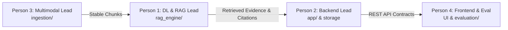

# Team Collaboration, Roles & Engineering Workflow

## 1. Project Team Roles & Ownership Matrix

The project is executed by a four-member engineering team. Module ownership is delineated to enable parallel workstreams without merge conflicts.

### Person 1 — Deep Learning & RAG Lead
- **Primary Modules**: `rag_engine/`, `app/services/generation.py`, `app/services/retrieval.py`
- **Responsibilities**:
  - Embedding model benchmarking and configuration (`sentence-transformers`).
  - Dense index construction and querying with FAISS.
  - Sparse lexical index configuration with `rank-bm25`.
  - Reciprocal Rank Fusion (RRF) algorithm implementation.
  - Optional Cross-Encoder reranking integration.
  - Grounded answer prompt design and hallucination guardrails.
  - Automated citation extraction and verification against retrieved text chunks.

### Person 2 — Backend & Integration Lead
- **Primary Modules**: `app/main.py`, `app/config.py`, `app/schemas.py`, `app/api/`, `docker-compose.yml`
- **Responsibilities**:
  - FastAPI routing, dependency injection, and middleware orchestration.
  - Centralized settings validation and secret redaction.
  - Metadata database schema (SQLite / PostgreSQL) and migration lifecycle.
  - Document lifecycle management (`uploaded` $\to$ `processing` $\to$ `indexed` $\to$ `failed`).
  - Persistent index serialization and disk storage safety.
  - Global error handling, structured logging, and production deployment configuration.

### Person 3 — Multimodal Processing Lead
- **Primary Modules**: `ingestion/`, `data/uploads/`
- **Responsibilities**:
  - File upload validation (MIME-type check, PDF magic headers, size boundaries).
  - High-fidelity PDF layout extraction using PyMuPDF (fitz).
  - Scanned page detection and Tesseract OCR fallback.
  - Table, equation, and figure caption extraction.
  - Document-level metadata extraction (title, authors, year).
  - Semantic chunking with page-span preservation and deterministic ID generation (`{doc_id}#chunk_{idx}`).

### Person 4 — Frontend & Evaluation Lead
- **Primary Modules**: `frontend/` (Streamlit / React), `evaluation/`, `tests/e2e/`
- **Responsibilities**:
  - Interactive research portal implementation (document upload, library, chat view).
  - Traceable citation viewer (clicking `[1]` highlights exact snippet and jumps to PDF page).
  - End-to-end integration testing and user journey test automation.
  - Evaluation harness development: retrieval metrics (Hit@K, MRR) and RAG triad evaluation (faithfulness, answer relevance).
  - Demo preparation, benchmark reports, and presentation artifacts.

---

## 2. Git Branching Strategy

The repository follows a trunk-based feature-branch workflow. The `main` branch is protected and always in a deployable, green-test state.

| Branch Name | Primary Owner | Scope |
| :--- | :--- | :--- |
| `main` | All (Team consensus) | Stable, verified releases; all tests passing |
| `feature/backend` | Person 2 | Routes, DB persistence, lifecycle state machine |
| `feature/ingestion` | Person 3 | PyMuPDF parsing, OCR fallback, semantic chunker |
| `feature/rag-engine` | Person 1 | FAISS, BM25, RRF fusion, reranker, LLM generation |
| `feature/frontend-evaluation` | Person 4 | Streamlit portal, citation viewer, evaluation harness |

---

## 3. Pull Request & Code Review Rules

1. **Schema Agreement First**: Before writing feature code that affects inter-module data transfer, owners must update and agree on `docs/API_CONTRACTS.md` or `app/schemas.py`.
2. **Atomic PRs**: Keep pull requests focused on a single milestone or feature.
3. **Mandatory Checks**:
   - `pytest tests/` must pass cleanly (100% green).
   - Code must pass linting (`ruff check .`).
   - No untracked cache files, database dumps, or real credentials.
4. **Peer Review**: Every PR requires at least one peer approval from the downstream or upstream module owner.

---

## 4. Handoff Interfaces Between Team Members

1. **Person 3 $\to$ Person 1 (Ingestion to Retrieval)**:
   - Contract: Ingestion delivers a list of `StableChunkMetadata` objects containing deterministic `chunk_id`, clean `text`, and exact `page_number`.
2. **Person 1 $\to$ Person 2 (Retrieval to API)**:
   - Contract: Retrieval engine provides query methods returning `List[RetrievedEvidence]` with normalized `scoring` structures.
3. **Person 2 $\to$ Person 4 (Backend to Frontend)**:
   - Contract: All endpoints conform strictly to `docs/API_CONTRACTS.md` JSON payloads.
